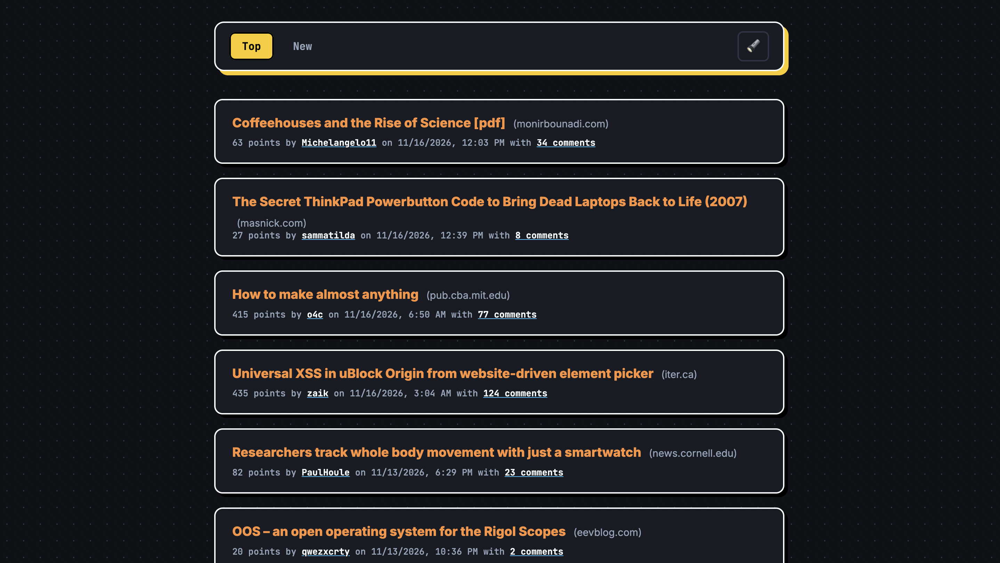
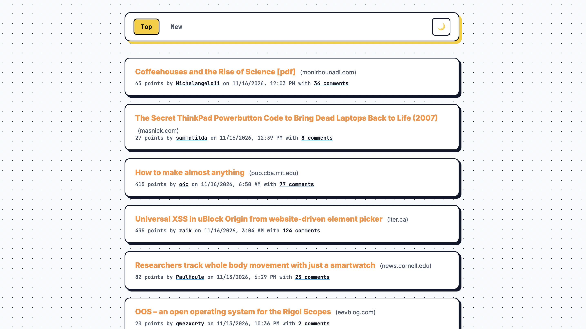

# 🚀 TypeScript Hacker News Clone (SSR)

A lightweight server-side rendered (SSR) Hacker News clone built with pure **TypeScript**, **Node.js**, and a modern ui.dev-inspired design aesthetic.

## 🛠️ Tech Stack
- **Backend / SSR:** Node.js (`http`), TypeScript, `tsx` (live-reloading)
- **Data Source:** Official Firebase Hacker News API (`/v0`)
- **Styling:** Vanilla CSS (CSS variables, light/dark theme, ui.dev style cards)

## 🚀 Getting Started

1. Install dependencies:
   npm install

2. Run the development server:
   npm start

3. Open in your browser:
   👉 http://localhost:3000

## 📸 Preview

| Dark Mode | Light Mode | Comments View | User Profile |
| :---: | :---: | :---: | :---: |
|  |  |  |  |

---
*Created as a hands-on learning project to master TypeScript and Node.js.*